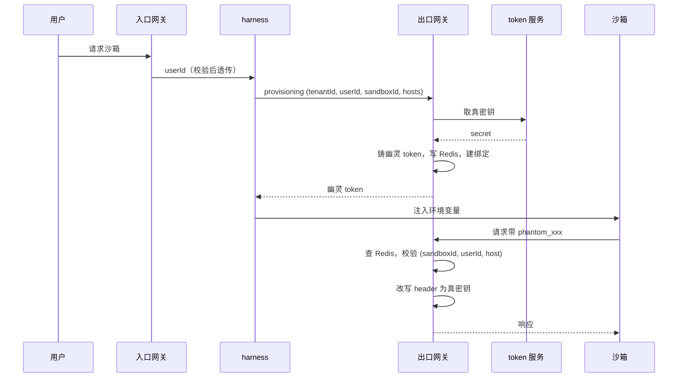

# ADR 0011: 幽灵 token 与网关侧 header 注入

Status: accepted（本项目决策）

## 背景

沙箱里的代码不可信。真密钥一旦进沙箱，等于交给不可信代码。

取法对象在网关改写请求头：容器出网经 Worker 的 `interceptOutboundHttp`，管理员在网关侧补 `Authorization`。我们的形状一样，但多一层：沙箱出示的不是真密钥，也不是“无凭据”，而是一个只在网关有意义的**幽灵 token**。

## 决策

**绑定表是宿主的策略数据。** 一条绑定：

```go
type Binding struct {
	Tenant   string
	User     string
	Sandbox  string
	Host     string // 精确 host，不做通配
	SecretID string
	Header   string // 例如 Authorization
	Prefix   string // 例如 "Bearer "
	Env      string // 注入沙箱的变量名
	Phantom  string
}
```

**绑定键是精确 host。** 不做 `*.example.com`。理由：通配绑定会把一个令牌送到该后缀下任何子域，包括用户内容域与第三方控制的子域。

**provisioning 用 `userId`，运行期用幽灵 token。**

provisioning：harness 经宿主控制面 unix socket（权限 `0600`）提交 `(tenantId, userId, sandboxId, hosts)`。网关为 `sandboxId` 创建数据面专属 Unix Domain Socket（`/run/egress/sandboxes/<sandboxId>/connect.sock`，即 L1 Socket Path Binding）与每沙箱临时根 CA，并按 `(tenantId, userId, host)` 向 token 服务取真密钥，铸幽灵 token，写 Redis，将 `(socketPath, caCertPEM, phantoms)` 返回给 harness 挂载/注入沙箱（无凭据绑定时 `hosts` 为空，仅创建专属 socket 与 CA）。

运行期：沙箱按普通凭据使用，请求经专属 socket 送达网关并带绑定 header 的幽灵 token。网关直接由专属 socket 的 listener 上下文获知权威 `sandboxId` 与 `sandboxCA`，查 Redis，换真值，再转发。



**幽灵 token 的形状**：`phantom_<sandboxId 前 8 位>_<128 位随机>`。前缀便于日志识别，`sandboxId` 前缀便于归属，随机保证不可枚举。顺序编号等于跨租户密钥，禁止。

**幽灵 token 绑定 `(sandboxId, userId, host)`。** 当前连接的实际 host（TLS SNI 与 HTTP `Host` 必须严格一致）与绑定不符即拒（`EHOSTMISMATCH`）。否则一个 token 能横向换到任意站点，或借域前置（Domain Fronting）送到同 IP 的其他主机。

**绑定 host 上按请求实际是否带了绑定 header 处理。**
- 未带 → 不注入，原样转发。匿名访问与“先无凭据、收到 401 再带凭据”的客户端（如 git）依赖这一条。不自动注入兜底：没有幽灵 token 就没有身份，注入哪一份都是猜。
- 带了 → 一律校验，通过才替换，绝不原样透传。值为本绑定的幽灵 token 则替换为真密钥；是幽灵 token 但不属于本沙箱或本 host 则 `EHOSTMISMATCH`；不是幽灵 token（含沙箱自带的真值）则 `EBADPHANTOM`。
- `Authorization: Basic`：base64 解码为 `user:password`，两个字段分别校验，等于幽灵 token 的字段替换为真密钥后重新编码；都不是幽灵 token 或解码失败则 `EBADPHANTOM`。

**未绑定 host**：剥离客户端自带的凭据头后，按 ADR 0010 的默认策略转发。剥离而不拒绝，因为拒绝会暴露“这个域名被登记过”。

**3xx 由网关跟随。** 跨 host 跳转或从 HTTPS 降级为 HTTP（80 端口）时丢弃已注入头，按新 host 重新查绑定（80 端口严禁注入凭据，绑定 host 上的 80 端口请求直接拒绝 `EDENIED`）。不写死这一条，一次跳转或明文降级就能把凭据带到攻击者的域名或明文链路上。

**真密钥的解析只在 provisioning 发生。** 请求路径只读 Redis 与网关本地缓存。token 服务不在数据面上，它抖动不该让全体沙箱断网。

**明文三不进**：不进 harness、不进沙箱、不出网关。日志与错误信息只出现幽灵 token 与 `secretId`。

**Redis 存密文，KEK 在网关。** 键为 `tenant/sandboxId/host`，TTL 5 分钟，由编排平台续期。续期停了就是“这个沙箱该死了”，此时按未绑定处理，不放行。

**吊销后期实现。** v1 没有吊销机制，不保证即时生效：删 Redis 键后，网关本地缓存（TTL 5 分钟）内的值仍可能被使用。Redis 不可达且缓存 miss 时一律 `deny`。

## 放弃的方案

**harness 持明文真密钥。** 放弃原因：harness 是链上最先被碰到的组件，被攻破即全泄露。

**自动注入兜底。** 放弃原因：查表键就是幽灵 token，缺失即无身份。

**通配绑定。** 放弃原因见上，子域即旁路。

**专用头 `X-Phantom-Token`。** 放弃原因：沙箱里的代码与工具要按普通凭据使用；复用绑定 header，示例代码不用改。

**每请求向 token 服务取密钥。** 放弃原因：把中心服务放进数据面。

## 后果

- 幽灵 token 会出现在沙箱里，模型能看到它。它不泄漏密钥，但它是指纹：日志里出现即可追溯到沙箱与用户。
- 绑定到无 SNI 的目标无法校验 host 一致性，所以**加载时就拒绝**。不能等到运行期静默失效。
- Redis 是数据面依赖。它挂了，全部绑定失效，全部请求被拒。
- 用户可能把幽灵 token 贴到外部服务去调试。它没用，但会出现在对方日志里。文档要写明这一点。
- `userId` 只在 provisioning 用一次。它不注入沙箱环境变量：不泄漏密钥，但会把用户身份交给不可信代码。

## 重新评估的触发条件

1. 出现跨沙箱复用幽灵 token 的需求：当前形状直接拒绝，回来后要重新设计身份。
2. 需要同一 host 多凭据（按路径区分）：绑定表加 `PathPrefix`，注入逻辑按路径分派。
3. provisioning 面从 unix socket 换成网络接口：必须同时加调用方认证，不能只靠网络位置。
4. 实现吊销：本地缓存必须能被吊销即时失效（如缓存命中仍校验 Redis 键存在，或吊销时广播清缓存），否则“删键即失败”不成立。
