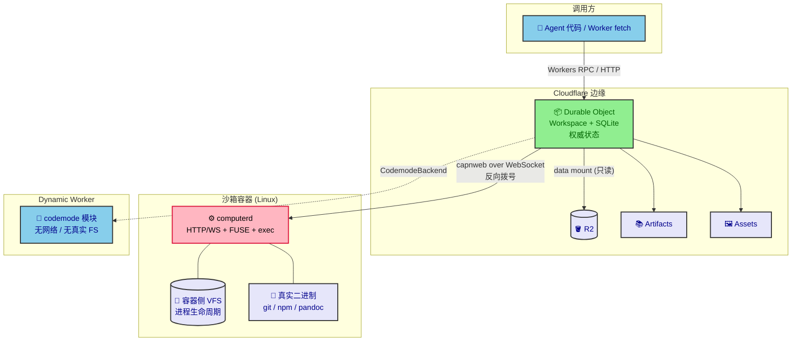
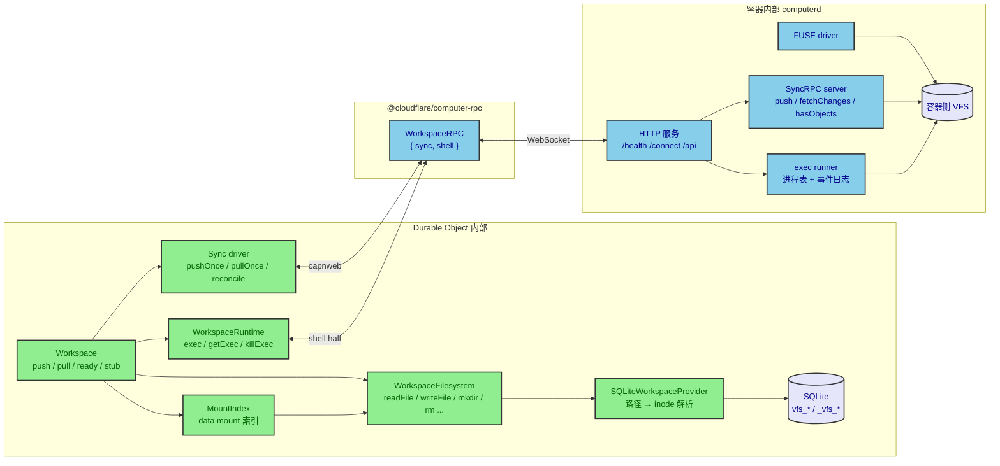
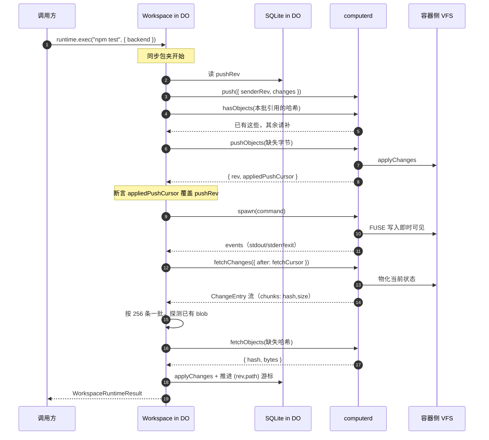
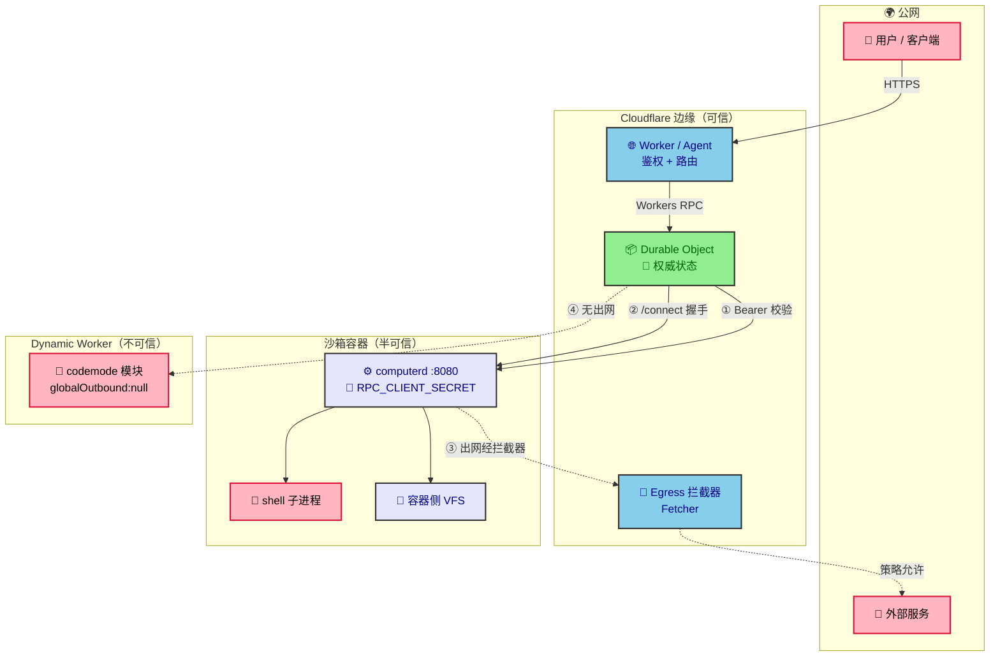

# Cloudflare Computer 架构梳理

> 基线：`cloudflare/computer` 主分支（浅克隆于 2026-03，`package.json` 版本线 0.11.x）。
> 引用规则：以 `packages/` 代码为准。`docs/` 为前瞻性规格，与代码不符处标 `⚠️`。
> 图源码同存 `docs/diagrams/*.mmd`。使用 `flowchart` 而非 Mermaid C4，避免渲染器差异。

## 目录

1. [定义与边界](#1-定义与边界)
2. [核心不变量](#2-核心不变量)
3. [结构](#3-结构)
4. [数据模型](#4-数据模型)
5. [同步协议](#5-同步协议)
6. [执行面](#6-执行面)
7. [生命周期](#7-生命周期)
8. [安全与网络](#8-安全与网络)
9. [性能与代价](#9-性能与代价)
10. [外围能力](#10-外围能力)
11. [规格与代码差异索引](#11-规格与代码差异索引)

---

## 1. 定义与边界

一句话：**一个放在 Durable Object 里的虚拟文件系统，加一个可插拔的执行出口。**

它解决三个问题：

1. Agent 需要一个可寻址、可跨重启的目录树，而 Worker 没有磁盘。
2. Agent 需要真工具（`git`、`npm`、`pandoc`），而 isolate 跑不了二进制。
3. 两者要看到同一份文件，且不需要调用方自己搬数据。

它明确**不做**这些事：

| 不做 | 后果 |
| --- | --- |
| 共享可变状态 | 没有 CRDT，冲突是 last-write-wins，会静默丢写 |
| 完整 POSIX | 无设备文件、无 `mmap` 语义、硬链接不过线 |
| 大仓库托管 | 上限约 10 GB，容器侧镜像在内存，目标是 agent 规模 |
| 跨工作区事务 | 一个 Workspace 一个权威库，没有跨库提交 |
| 授权 | `backend` 参数是路由，不是权限 |

关键取舍用一句话概括：**用“容器随时可丢”换“状态永远在”**。这条决定了同步协议、水位线、以及容器被当成消耗品。

---

## 2. 核心不变量

后面每一章都引用这组编号。破坏任一条，系统就不是这个系统了。

| # | 不变量 | 载体 |
| --- | --- | --- |
| **I1** | 只有 Host store 里的数据算数。容器侧是一份可丢弃的镜像。 | ADR 0001 |
| **I2** | 一个 DO 实例内的写入由输入门串行化。同实例内不存在写-写冲突。 | DO 运行时 |
| **I3** | `rev` 单调递增。每个 `rev` 命名一个已提交的树状态。`vfs_meta.rev` 严格大于所有节点与变更的 `rev`。 | `vfs_meta` |
| **I4** | 水位线与它描述的数据在同一事务里写。两者不会漂。 | `_vfs_watermark` |
| **I5** | 字节按内容哈希寻址。线上传条目与哈希，不内联字节。 | `vfs_blobs` |
| **I6** | 重放幂等。`apply` 用 `alreadyApplied` 丢弃已应用条目；游标是 `(rev, path)`，可在一批内续传。 | `sync/apply.ts` |
| **I7** | 执行句柄绑定容器进程的 runtime UUID。容器换掉后，旧 id 不落到新进程。 | `EEXEC_LOST` |
| **I8** | 命令执行的 push 是安全门。push 失败就不 spawn。 | `runtime/runtime.ts` |

I1 与 I8 合起来给出用户可见的保证：**命令看到的文件，至少是 DO 上已提交的状态**。反方向的保证（命令的写入一定回到 DO）是弱的：pull 可以失败，失败后报 `sync.status: "pending"`，稍后续传。

---

## 3. 结构

### 3.1 容器视图



四条边值得记住：

- **调用方 → DO**：Workspace 就是 DO。`stub()` 把 Workspace 包成可跨 Workers RPC 的桩。
- **DO ↔ 容器**：一条长连 WebSocket，capnweb 文本帧。方向是容器拨出（ADR 0005）。
- **DO ⇢ codemode**：不是长连。`CodemodeBackend` 用 `env.LOADER` 铸一个 Dynamic Worker，调用通过 Workers RPC 回调宿主。
- **DO → R2 / Artifacts / Assets**：都是可选的数据源或出口，不是核心路径。

### 3.2 组件视图



组件边界只有三条是承重的：

1. `WorkspaceFilesystem` 只写本地库。它不知道网络存在。
2. `Sync driver` 只搬条目与对象。它不知道文件语义。
3. `computerd` 的两个半边（FUSE 与 exec）共享同一个容器侧 VFS，因此命令能看到 FUSE 的写入。

`dofs` 包提供 1 与 2 的零件，`rpc` 包提供线协议，`computer` 包把它们装起来。

### 3.3 代码与包

| 包 | 角色 | 状态 |
| --- | --- | --- |
| `@cloudflare/dofs` | SQLite VFS、schema、同步零件 | 稳定（同步零件除外） |
| `@cloudflare/computer-rpc` | capnweb 线类型、server / client / driver | 实验 |
| `@cloudflare/computerd` | 容器内守护进程 | 实验 |
| `@cloudflare/computer` | Workspace 包装 + runtime + 三后端 | 稳定（容器 / worker-shell 后端除外） |
| `packages/remote-exec` | Rust 二进制，跨容器执行 | 实验 |

---

## 4. 数据模型

全部表以 `vfs_` 或 `_vfs_` 开头，避免与调用方自己的表冲突。

### 4.1 表

| 表 | 内容 | 关键点 |
| --- | --- | --- |
| `vfs_meta` | schema 版本与单例 | 持有全局 `rev`。I3 靠它成立。 |
| `vfs_nodes` | inode 元数据（类型、mode、mtime、size、rev） | `size` 冗余存储，避免每次 `stat` 聚合 |
| `vfs_dirents` | 名字 → inode | 改名只需改这里，O(1) |
| `vfs_blobs` | chunk 元数据（hash → size, last_seen） | 内容寻址入口 |
| `vfs_blob_bytes` | chunk 字节 | 与 `vfs_blobs` 一对一 |
| `vfs_chunks` | 文件 → 有序 chunk 列表 | 一个文件的字节序列 |
| `vfs_manifests` | chunk 列表的哈希 | 让接收方一次判断“已有整段” |
| `vfs_changes` | 墓碑与变更记录 | 删除靠它传播 |
| `_vfs_watermark` | `pushRev` 等 | I4 |
| `_vfs_fetch_cursor` | `(rev, path)` 游标 | I6，批内续传 |
| `_vfs_mounts` | data mount 索引 | 只读根的重叠检查 |

### 4.2 节点状态机

文件节点只有两种形状：

```
lazy stub:    stub_size NOT NULL, 无 vfs_chunks 行
   │  第一次读 → 向 provider 取字节
   ▼
committed:    0..N 个 vfs_chunks 行, manifest_hash 可选
```

`manifest_hash` 为 `NULL` 时，同步逐个走 `vfs_chunks`；有 manifest 时，接收方先比对 manifest 哈希，跳过整个文件的 chunk 探测。

### 4.3 完整性约束

- 根目录永远是 `inode = 1`，类型 `dir`，无父目录项。
- 每个文件的 `size = COALESCE(SUM(chunks.size), 0)`，与 `mode` / `mtime` / `rev` 同一条 `UPDATE` 写入。
- 每条 `vfs_chunks.hash` 必须存在于 `vfs_blobs`。每条 `vfs_blobs.hash` 必须有对应 `vfs_blob_bytes`。
- 每条 `vfs_dirents.child_inode` 必须存在于 `vfs_nodes`。

这些约束不是文档口号，它们在每次写入路径上被检查。`rm` 与 `writeFile` 的测试专门盯它们。

### 4.4 垃圾回收

`gc()` 扫 `vfs_blobs` 与 `vfs_manifests`，删除无引用且 `last_seen` 超过安全窗口（默认 60 秒）的行，级联删字节。

作者刻意不把 `gc()` 放到公开 API。理由写在文档里：agent 不该驱动回收，函数形状（可注入 `now`）是为测试而不是为产品。这个判断值得记住：**能省的抽象就省**。

---

## 5. 同步协议

### 5.1 一轮完整往返



关键点：

- **不内联字节。** 上下行都先传哈希，再按需补字节。往返固定 2 次，不随文件数增长。
- **合并单元是路径。** 两次 exec 之间同一路径改五次，线上只发一条最终状态。
- **游标是 `(rev, path)`。** 大改动中断后从批内位置续，不重放整个 `rev`。
- **断言在水位上。** 每次 push 与 fetch，接收方回显 `appliedPushCursor`，发送方断言它覆盖自己的 `pushRev`。水位倒退不会静默。

### 5.2 水位线

| 水位 | 归属 | 含义 |
| --- | --- | --- |
| `pushRev` | DO | 已成功推送到容器的最后一个 DO 侧 `rev` |
| `fetchCursor` | DO | 已从容器拉到的最后位置；`path = null` 表示该 `rev` 内全部已提供 |
| `currentRev` | 两侧各自 | 本侧最后一次变更铸造的 `rev` |
| `appliedPushCursor` | 容器 | 已应用的 DO 侧游标，每次响应回显 |

`fetchCursor` 是**续传点，不是快照句柄**。`coalesceChanges` 在流打开时才物化路径的当前状态，因为库里不保存历史。若某路径在游标推进后又被改写，它的新 `rev` 会大于 `currentCursor.rev`，于是被本次流丢弃、在后续游标下重发。收敛成立，但“游标 5 的树”不等于“rev 5 的快照”。

### 5.3 `senderRev` 的两种语义

同一个 `push` 方法服务两类写者：

| 值 | 写者 | 接收方动作 |
| --- | --- | --- |
| `> 0` | 同步对端 | 按 `upstream` 应用，推进自己的拉取游标 |
| `= 0` | 外部编排器 / 空白接收方 | 按 `local` 应用，逐条提升自己的 `currentRev`，**不动出向水位** |

第二个分支是修 bug 修出来的。缺了它，外部写入会被接收方吞掉，再也不会往上游同步。

### 5.4 冲突

系统里只有一种策略：**last-write-wins**。

- 同实例内没有冲突，输入门串行化（I2）。
- 跨容器冲突时，后同步到的覆盖先到的，不报错。
- 类型冲突（文件变目录）时，接收方删掉本地子树再应用上游。子树里的本地独有内容随之消失，没有单独墓碑。

文档自己列出了会丢数据的三种模式：

1. 多个写者改同一文件。
2. 跨容器读-改-写（计数器丢增量）。
3. 无同步点的 agent 交接。

给出的用法约束很硬：**同时只有一个活跃写者；按子树分区；把工作区当草稿，不当共享可变状态**。

### 5.5 失败处理

| 故障 | 行为 |
| --- | --- |
| WebSocket 断开 | 丢掉 Handle，下次 `ready()` 重新握手。push/pull 内部重试一次。 |
| push 中断 | 水位未推进，重放。接收方整批在一个事务里应用，看不到半批。 |
| pull 中断 | 从最后提交的批续。最多重取 256 条。 |
| 容器在命令执行中挂掉 | 命令不重放。`getExec` / `killExec` 遇到新 runtime 返回 `EEXEC_LOST`。 |
| 命令完成后 pull 失败 | 结果仍是 `completed`，`sync.status: "pending"`。后续 `pull()` 续传。 |
| 后续 pull 到达另一个容器 | 抛 `WorkspaceSyncLostError`，一次性，带丢失的 runtime id；下次 `pull()` 正常同步新容器。 |

命令不重放这条很关键。传输在 spawn 之后断开时，DO 无法判断命令是否已开始，所以报“可能已启动”，让调用方决定。

---

## 6. 执行面

### 6.1 一个入口

```ts
const handle = await workspace.runtime.exec(source, {
  backend: "container-shell",   // 路由，不是授权
  cwd: "/workspace",
  encoding: "utf8",
  timeoutMs: 30_000,
  input: { ... },               // 仅 callable 后端
  metadata: { userId: "u1" },   // 只给宿主模块看，运行代码看不到
});
const result = await handle.result();
```

Handle 同时是 `ReadableStream<event>` 与结果来源。单消费者：要么读流，要么 `result()`，不能两边都来。

### 6.2 三个后端

| id | 源码语言 | 同步模式 | 进程生命周期 | 网络 |
| --- | --- | --- | --- | --- |
| `container-shell` | shell 命令 | `remote` | 有进程表、事件日志、信号、可重连 | 真实，可配策略 |
| `worker-shell` | just-bash 命令 | `none` | 一次调用，缓冲返回，不可按 id 重连 | 无（默认关闭出网） |
| `codemode` | ECMAScript 模块 | `none` | 执行日志在 Workspace 库，可 `getExec` / `dispose` | 无（`globalOutbound: null`） |

`sync: "none"` 的后端直接复用 Host store。push/pull 是空操作，连接时跳过水位对齐。这就是 worker-shell 与 codemode 能做到“零同步”的原因：它们没有第二份存储。

### 6.3 后端抽象

```ts
interface WorkspaceBackend {
  readonly id: string;          // 用户给定，可用于多实例
  readonly type: string;        // 诊断用
  readonly callable?: boolean;  // 是否收结构化 input
  readonly description?: string; // 给模型看的自述
  connect(host): Promise<BackendHandle>;
}

interface BackendHandle {
  rpc: WorkspaceRPC;            // { sync, shell }
  runtimeId?: string;           // 容器进程身份，I7
  sync?: "remote" | "none";
  ignore?: { patterns; root; supported };
  closed?: Promise<void>;       // 传输断开时 resolve
  close(): Promise<void>;
}
```

接口刻意很窄。同步与执行的具体方法都在 `rpc` 上，Workspace 不认识它们的签名。加一个新后端不需要改 Workspace。

### 6.4 输出截断

所有后端共用一套限额，模型抄的是 pi 的 bash 工具：2000 行 / 64 KiB。

超出部分不丢，流式写入 `/.computer/output/<backend>.<id>.stdout.log`，结果里给出路径。内存只保留尾部窗口。二进制输出按字节保存，读工具按内容识别图片。

这条设计针对 agent 场景：模型需要看结尾，人需要看全文，全量塞进上下文会爆。

### 6.5 权限

没有统一的 `scope()` 抽象。权限由后端构造时固定：

```ts
new CodemodeBackend({ id: "codemode-readonly", access: "read", ... });
new CodemodeBackend({ id: "codemode", access: "read-write", ... });
```

要不同权限就注册多个实例。文档明确写：**`backend` 参数永远不是授权**，公开网关必须自己校验签名能力允许选哪个后端。

---

## 7. 生命周期

### 7.1 DO 的化身序列

| 事件 | 留下 | 丢掉 |
| --- | --- | --- |
| 冷启动 | `ctx.storage` | 全部内存状态 |
| 驱逐 / 休眠 | `ctx.storage`、可休眠 WebSocket 及其附件 | 内存、不可休眠 WebSocket |
| 重启 / 重新部署 | `ctx.storage` | 内存、全部 WebSocket |
| OOM | 已提交事务 | 内存、WebSocket、未提交写入 |

`Workspace` 在 DO 构造器里创建，`#handle` / `#shell` / `#readyPromise` 全在内存，跨化身必丢。活下来的是三样：

1. SQLite 里的文件。
2. 水位行，且与数据同事务写入（I4）。
3. 每个执行 id 最近的容器 runtime UUID（I7）。

新化身第一次 `ready()` 重新走 `connect()`。容器还活着就复用，死了就 rev-0 重建。

唤醒源不分轻重：外部 `fetch`、服务绑定、容器出网回调、alarm、可休眠 WebSocket 的消息，都会唤醒 DO。

### 7.2 容器

容器独立于 DO。1:1 映射是承重的，理由有三：

1. 容器的 WebSocket 对端唯一。
2. 持久水位只对一个对手方说话。
3. 休眠可行：不必多路复用多个 WS 对端。

容器侧 VFS 默认是进程生命周期。容器重启，本地状态与水位一起丢，下一次 push 从 rev-0 重建基线。

### 7.3 休眠

作者把休眠当作设计约束，不是优化项。`ctx.acceptWebSocket()` 只对服务端接受的 WebSocket 有效，这正是反向拨号存在的原因（ADR 0005）。反过来，DO 主动连容器就会永久关掉这扇门。

未解完的部分作者写在文档里：休眠期间容器是否保活、闹钟与容器的配合、以及“反向拨号失败时谁来唤醒谁”。这一节标着「仍需解决」，不是既成事实。

### 7.4 跨生命周期交互

```
DO 化身 N ──(驱逐)──▶ 化身 N+1
   │                      │
   │ 容器仍活             │ ready() 重新握手
   └──────────────────────┘
              │
        容器也被换掉
              │
        rev-0 重建 + 旧执行 id 全部失效
```

---

## 8. 安全与网络

### 8.1 六道边界

| # | 边界 | 机制 |
| --- | --- | --- |
| 1 | DO ↔ 容器认证 | `RPC_CLIENT_SECRET`：设置后除 `/health` 外所有路由要求 `Bearer` |
| 2 | 连接方向 | 容器拨出到 `/connect`。DO 不主动连容器。 |
| 3 | 容器出网 | `container.interceptOutboundHttp` 回到 DO 的 `Fetcher`；策略 `none` / `direct` / `http-gateway` |
| 4 | isolate 出网 | `globalOutbound: null`（`none`），或指向网关 `Fetcher` |
| 5 | 路径限制 | `resolvePath` 拒绝逃逸与穿越符号链接；只读 mount 抛 `EROFS` |
| 6 | 密钥生命周期 | `RPC_CLIENT_SECRET` 读后从 `process.env` 删除，shell 子进程拿不到 |

### 8.2 部署与信任边界



读法：颜色越红，信任越低。DO 是唯一持有权威状态的位置，所以它不出让任何门禁给下层。

### 8.3 三个必须理解的弱点

**无密钥即全开。** `computerd` 未设 `RPC_CLIENT_SECRET` 时，`/api`、`/__computerd/*` 全部开放。容器内的任何进程都能连。生产必须设。

**密钥是静态的。** 一个 Workspace 一个 secret，没有轮换与过期。容器被换掉时密钥随环境重发。

**隔离等级不同，不是同一件事。** codemode 无网络、无真实文件系统、靠宿主模块拿能力；container 有完整 Linux 与真实网络。选后端等于选攻击面。文档把这条写成“后端构造时固定最大权限”，因为运行期收不回来。

### 8.4 Go 版必须自己解决的三件事

上游把这三件交给平台代管，迁到 Go 不会免费得到：

| 问题 | 上游现状 | Go 版要做的 |
| --- | --- | --- |
| 谁生成密钥 | 平台注入 `RPC_CLIENT_SECRET` | 生成、下发、重启后重放 |
| 谁校验 | `computerd` 路由中间件 | 每个入口一致地校验，`/health` 例外要有理由 |
| 会话过期 | 无 | 过期、吊销、重连时的重新认证 |

---

## 9. 性能与代价

### 9.1 数字

`fs-bench`，相对 ext4 磁盘（小于 1 表示更快）：

| 场景 | 相对 ext4 | 含义 |
| --- | --- | --- |
| `rm` 1000 文件 | **0.66x** | 内存 inode 比真盘快 |
| `mkdir` 树 10×10×10 | **0.74x** | 同上 |
| `find` 树 | **0.72x** | 同上 |
| `stat` 1000 文件 | **0.91x** | 同上 |
| `git init` + commit 100 文件 | **0.72x** | 元数据密集 |
| `git clone`（浅，~1 MB） | **0.84x** | 同上 |
| 写 64 MiB | 16.9x | 每 512 KiB 算一次哈希 |
| 读 64 MiB | 39.7x | FUSE + 分块 |
| 完整 `npm install` | 124.7 s（磁盘 63.9 s） | 约 2 倍 |

规律很干净：**元数据密集快于磁盘，大顺序 IO 慢一到两个数量级。**

### 9.2 数字没算的东西

`npm install` 那张表只测到命令返回。之后把 36,675 个文件搬进 DO 的 pull 不算在内，而文档自己说“对依赖树来说那才是更大的成本”。

issue #179 记录了真实现场：安装 120 秒超时，再花约 3 分钟 pull，随后下一个命令撞上存储超时且没有恢复。

所以正确读法是：**挂载速度不是同步速度**。评估工作负载时要么自己加上传输时间，要么用 `MOUNT_IGNORE` 把 `node_modules` 留在容器本地。

### 9.3 代价清单

| 代价 | 来源 | 缓解 |
| --- | --- | --- |
| 约 10 GB 上限 | 与 DO 共享存储 | 分工作区 |
| 大文件吞吐差 | 哈希 + FUSE | 把大文件留在容器（`MOUNT_IGNORE`） |
| 冲突静默丢写 | LWW | 单写者 + 分区 |
| 首次容器启动慢 | 启动 + 健康轮询 + 握手 | 后端懒连接，只在首次使用付出 |
| 协议无版本协商 | 成对部署 | DO 与 `computerd` 锁步发布 |

---

## 10. 外围能力

一页清单。这些不改变主干的形状，都是“用 Workspace 当底座”的增值件。

| 能力 | 位置 | 做什么 |
| --- | --- | --- |
| `workspace.git` | `computer/src/git` | isomorphic-git 客户端；`git` CLI 也在 shell 里可用 |
| Assets | `computer/src/assets` | 把工作区文件发到 R2，拿预签名 URL |
| Artifacts | `computer/src/artifacts` | 生成可 clone 的 Worker 项目仓库 |
| `codemode:git` / `:artifacts` / `:assets` / `:tools` / `:container` | `computer/src/modules` | 让隔离 JS 通过宿主模块拿能力 |
| `codemode:exec` | `computer/src/remote-exec` | 在任意容器 DO 里跑命令，文件推进去再拉回来 |
| Agent 工具适配 | `computer/src/tools/{ai-sdk,pi-ai,tanstack-ai}` | read / write / edit / ls / exec / publish |
| data mount | `computer/src/mounts` | R2 与 Worker bundle 铺成只读子树 |
| MCP 示例 | `examples/mcp` | 一个 Code Mode `code` 工具 + 一个耐久工作区 |

外围件里只有一处设计值得单独记：**`codemode:*` 模块共用一套 host 模块协议**。工厂拿 `{ git, artifacts, runtime, assets }`，函数拿到 `{ signal, deadline, access, resolvePath, callId, execution, interrupt }`。`callId` 是幂等键，`interrupt` 让执行在等人审批时释放自己、恢复后重放。这套协议是外围件能长在主干上而不改主干的原因。

---

## 11. 规格与代码差异索引

`docs/` 是前瞻性规格。以下是已核实的出入。阅读任何一章时遇到“规格这么说”的地方，先查这张表。

| # | 位置 | 规格说 | 代码是 | 判定 |
| --- | --- | --- | --- | --- |
| 1 | `docs/01_vfs.md` §Mount roots | “mount 功能尚未实现”，`EROFS` “今天没有生产调用点” | `mounts/` 有 R2 与 worker-bundle provider；`workspace.ts:311` 构造 `MountIndex`；`mkdir.ts:183`、`rm.ts:111`、`writeFile.ts:223` 调用 `assertNotReadOnly`，生产路径会抛 `EROFS` | ⚠️ 规格落后，功能已实现 |
| 2 | `docs/01_vfs.md` §Reserved paths | mount 根“计划中不可删除” | 只读根由 `mount-guard.ts` 的对称重叠判断拦截 | ⚠️ 同上 |
| 3 | `docs/02_sync_protocol.md` 首行 | “实验性，不保证可用” | `backend.ts` 的 `sync: "remote"` 已是一等公民，容器后端稳定使用 | 状态标注保守，非冲突 |
| 4 | `docs/README.md` §性能 | 强调元数据快 | 未提 pull 成本在 `npm install` 场景占大头（§19 有，README 无） | ⚠️ 概览漏了最大的成本项 |
| 5 | `docs/05_runtime_interface.md` | `container-shell` 有完整进程生命周期 | 与 `packages/computer/src/backends/container` 一致 | 一致 |
| 6 | `docs/16_code_execution.md` | “执行跨重启被协调为 failed” | codemode 的日志确实落库，活 Worker 无法序列化 | 一致 |
| 7 | `docs/07_injected_service.md` | `/health` 在 socket 绑定后即 200 | 代码在 FUSE 挂载完成后才 `listen`，所以 `/health` 通即 FUSE 已就绪 | 一致（文档已说明） |

复核方法：`grep -rn "assertNotReadOnly" packages/dofs/src`、`grep -n "MountIndex" packages/computer/src/workspace.ts`。

---

## 附：读这份文档的顺序建议

- 只想理解机制：1 → 2 → 3.1 → 5.1 的时序图。
- 想动手复刻：2 → 4 → 5 → `docs/architecture/go-mapping.md`。
- 想评估风险：2 → 8 → 9.3。
